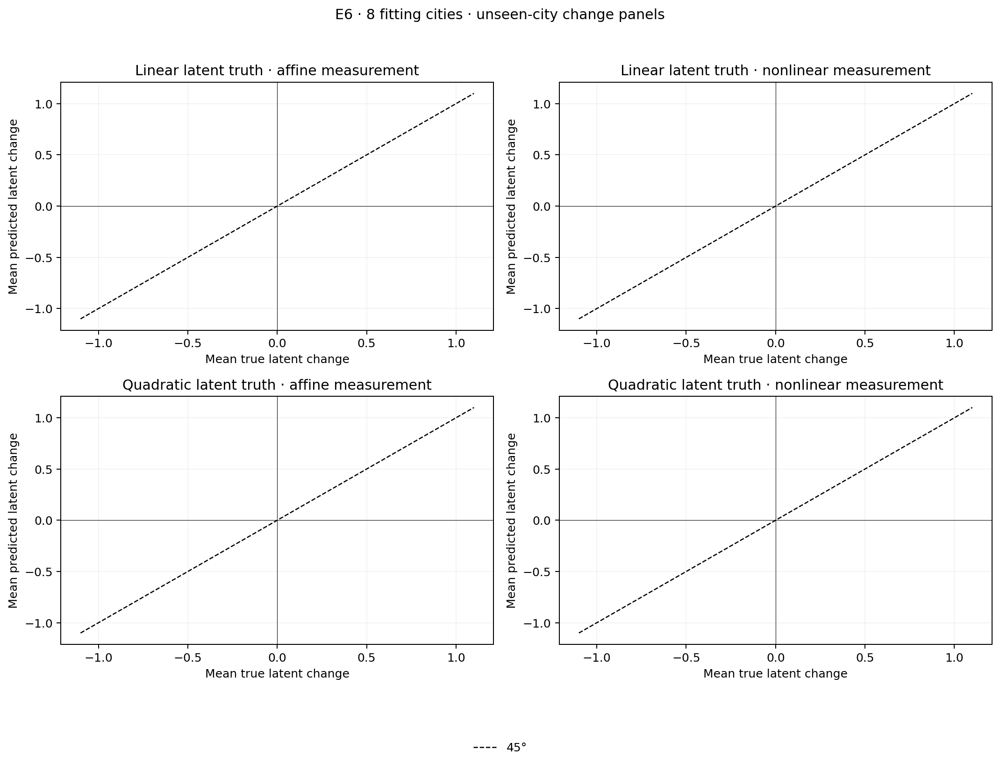

# E6: outcome levels and within-tract changes

Completed 2/2 paired jobs. Full configured design.

The figure shows direction-specific mean changes at each nonzero E5 step size, with 95% t intervals across independent replications. The dashed line is exact mean recovery. Individual-change RMSE is reported separately; good group means do not imply precise individual magnitudes. All latent scorers, including both privileged references, use the E5 fitting-pair dispersion normalization. `normalization_only_rmse` records its finite-sample effect even for the true structural function.

Selection uses fitting/validation observations only. A uses validation rank logistic loss; B and C use the fixed rank-plus-standardized-level validation rule, independent of training lambda. D receives exactly C’s executed additional scorer updates and restores its best rank-validation checkpoint; D_common instead restores its best checkpoint under C’s common rule using the frozen B head. D outcome predictions use separate post-hoc calibration without scorer updates.

The following direct paired comparisons use the largest city count, the quadratic/ReLU case when present, and step size 0.4 when present. Negative differences improve RMSE; positive differences improve sensitivity. Detection also requires inspecting its cutoff and fresh-stable false-positive rate in `summary.csv`. All other conditions and D_common comparisons are in `paired_differences.csv`.

| Measurement | Head | Target | Contrast | Difference [95% CI] |
|---|---|---|---|---|

## Separate conclusions

**Latent magnitudes.**

**Detection sensitivity.**

**Reported outcome changes.**

Better reported outcome changes alone are successful outcome calibration. They do not establish improved latent cardinal recovery. Stable-tract RMS, cutoff and sensitivity by actual size distinguish stronger true-change response from lower nuisance movement. Cell-specific heads have no zero-shot unseen-city outcome predictions. Privileged ML knows the structural basis, mixing, measurement map and noise law; the noisy-R oracle instead uses the same scorer architecture and noisy inverse labels.

Intervals treat replications as sampling units, retain all finite completed seeds, and use no seed selection. They are pointwise, with no multiplicity adjustment. This report describes this finite design and budget; it is not an identification claim.